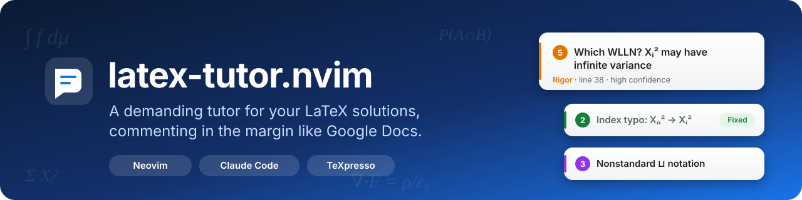
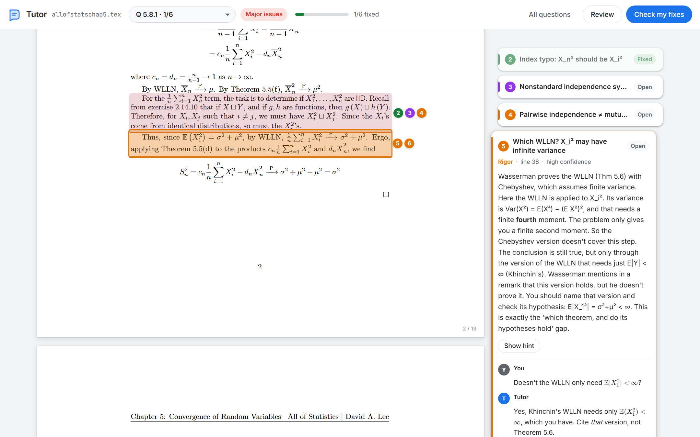
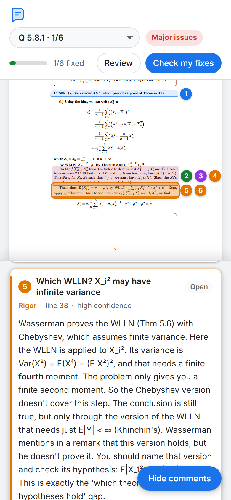
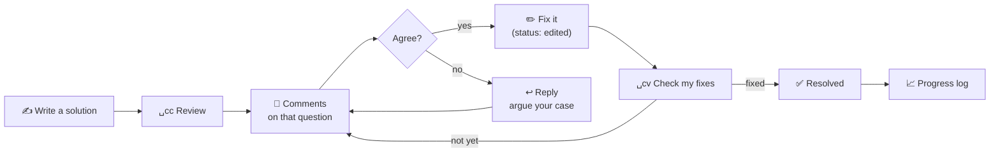
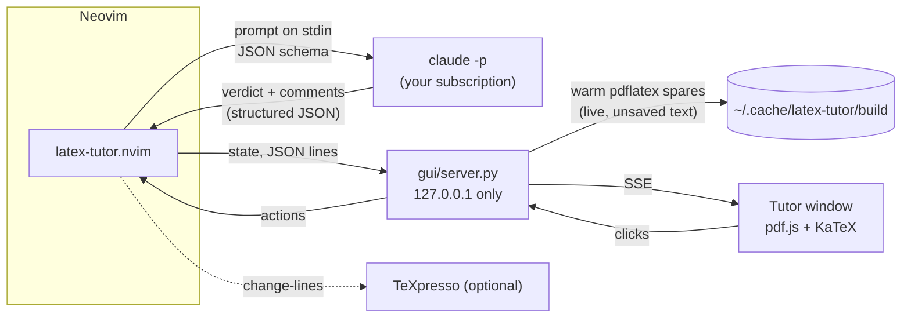

<div align="center">



<br>

**Write your solution in Neovim. Press three keys. A tutor reads it, redoes the math,<br>
and leaves comments in the margin of your compiled PDF, one question at a time.**

<br>


[Features](#-features) ·
[Requirements](#-requirements) ·
[Install](#-install) ·
[Quick start](#-quick-start) ·
[Keys](#%EF%B8%8F-keys) ·
[How it works](#-how-it-works) ·
[FAQ](#-troubleshooting)

</div>

<br>

<picture>
  <source media="(prefers-color-scheme: dark)" srcset="docs/gui-dark.png">
  
</picture>

<p align="center"><sub>The Tutor window: your compiled PDF, with comments aligned to the lines they're about.<br>
Math in comments is rendered with KaTeX, using your own macros (<code>\E</code> → 𝔼).</sub></p>

<br>

## ✨ Features

<table>
<tr>
<td width="50%" valign="top">

### 🪟 A real review window
Your document is compiled and shown as a PDF. Each comment is a card in the
margin, next to the line it's about, as in Google Docs. Click a card and nvim
jumps there. Double-click the PDF and nvim jumps to that source line.

**It updates as you type**: about half a second after you pause, with no
saving. A half-typed `\frac{` never breaks it, and pages never flicker.

</td>
<td width="50%" valign="top">

### 🎯 One question at a time
The tutor shows only the exercise your cursor is in. Each comment is one line
until you open it. Move to another exercise and its comments appear instead.

</td>
</tr>
<tr>
<td valign="top">

### ✅ Tracks your fixes
Each comment is **open**, **edited** (you changed the line it points at), or
**fixed**. Press *Check my fixes* and the tutor re-reads your edits and
closes what you actually fixed. A bar shows **3/5 fixed**.

</td>
<td valign="top">

### 💬 Argue back
Reply on any comment: "I think pairwise independence is enough here". The
tutor answers, and closes the comment if you convinced it.

</td>
</tr>
<tr>
<td valign="top">

### 🧠 Tutoring on your terms
A Markdown file, `TUTOR.md`, tells the tutor how you want to be taught:
hints before answers, what to check hardest, what to ignore.

</td>
<td valign="top">

### 💳 On your Claude subscription
It runs Claude Code headlessly with your claude.ai login. There's no API key
and no per-token bill. The plugin removes API keys from the reviewer's
environment, so it can't fall back to metered billing.

</td>
</tr>
<tr>
<td valign="top">

### 📈 Private progress report
Each review is logged outside every git repo. `␣cs` shows your score per
manual and per chapter, a weekly trend, and the mistakes you keep making.

</td>
<td valign="top">

### ⚡ Also inside the terminal
Without the window you get highlights, gutter numbers, a floating card and a
sidebar checklist in nvim. If you use
[TeXpresso](https://github.com/let-def/texpresso), comments also appear as
numbered badges in its preview. It's optional: the window has its own live preview.

</td>
</tr>
</table>

<br>

<div align="center">

<br><sub>Narrow windows move the comments into a bottom sheet, and the view follows the active card.</sub>
</div>

<br>

## 📋 Requirements

<table>
<tr><th></th><th>What</th><th>Version</th><th>Check it</th><th>Needed for</th></tr>
<tr><td>✅</td><td><b>Neovim</b></td><td>≥ 0.10 (tested 0.11.4)</td><td><code>nvim --version</code></td><td>everything</td></tr>
<tr><td>✅</td><td><b>Claude Code CLI</b>, signed in with a <b>Pro or Max</b> plan</td><td>≥ 2.1 (tested 2.1.296)</td><td><code>claude auth status</code> → <code>"authMethod": "claude.ai"</code></td><td>the reviews</td></tr>
<tr><td>✅</td><td>Linux, macOS or <b>WSL2</b> (a Unix shell with <code>env</code>)</td><td>any</td><td><code>env --version</code></td><td>launching the reviewer</td></tr>
<tr><td>🪟</td><td><b>Python 3</b>, standard library only (nothing to <code>pip install</code>)</td><td>≥ 3.8</td><td><code>python3 --version</code></td><td>the Tutor window</td></tr>
<tr><td>🪟</td><td><b>TeX Live</b> or <b>MacTeX</b>, which provide <code>pdflatex</code> and <code>synctex</code></td><td>TeX Live ≥ 2020</td><td><code>pdflatex --version</code> and <code>synctex help</code></td><td>the PDF and live preview</td></tr>
<tr><td>🪟</td><td>A browser. A Chromium one (<b>Edge</b>, Chrome, Chromium) gives a chromeless app window</td><td>any recent</td><td></td><td>showing the window</td></tr>
<tr><td>➕</td><td>A plugin manager, e.g. <a href="https://github.com/folke/lazy.nvim">lazy.nvim</a></td><td>any</td><td><code>:Lazy</code></td><td>installing (or use <code>runtimepath</code>)</td></tr>
<tr><td>➕</td><td><a href="https://github.com/let-def/texpresso">TeXpresso</a> + <a href="https://github.com/let-def/texpresso.vim">texpresso.vim</a></td><td>any</td><td><code>:lua print(require("texpresso"))</code></td><td>badges in TeXpresso's own preview. <b>Not needed:</b> the window has its own live preview</td></tr>
</table>

<sub>✅ required · 🪟 required for the Tutor window · ➕ optional</sub>

No API key, no `pip`, no `npm` packages and no build step. pdf.js, KaTeX and
marked are bundled in `gui/static/vendor/`, so the window works offline.

> [!IMPORTANT]
> **Your documents must compile with `pdflatex`** (or set
> `gui = { engine = "xelatex" }` / `"lualatex"`). They're built into
> `~/.cache/latex-tutor/build/` and never next to your files, so any `build/`
> folder you use is untouched.

<br>

## 📦 Install

Each step ends with a command that checks it worked.

### 1. Neovim ≥ 0.10

Ubuntu's `apt` package is usually too old, so use the official release:

```bash
# Ubuntu / WSL2
curl -LO https://github.com/neovim/neovim/releases/latest/download/nvim-linux-x86_64.tar.gz
sudo tar -C /opt -xzf nvim-linux-x86_64.tar.gz
echo 'export PATH="/opt/nvim-linux-x86_64/bin:$PATH"' >> ~/.bashrc && source ~/.bashrc

# macOS
brew install neovim
```

✔ `nvim --version` prints `NVIM v0.10` or newer.

### 2. Claude Code, signed in with your subscription

```bash
curl -fsSL https://claude.ai/install.sh | bash   # or: npm install -g @anthropic-ai/claude-code
claude                                            # sign in once, then type /exit
```

When it asks how to sign in, choose **Claude account with subscription**, not
an API key.

✔ `claude auth status` shows `"authMethod": "claude.ai"`.

### 3. TeX Live (pdflatex + synctex) and Python 3

```bash
# Ubuntu / WSL2: the common packages (~1 GB)
sudo apt install texlive-latex-extra texlive-science texlive-pictures python3
# ...or everything, if your documents use unusual packages (~5 GB)
sudo apt install texlive-full

# macOS (Python 3 ships with the Xcode command-line tools)
brew install --cask mactex-no-gui
```

✔ `pdflatex --version`, `synctex help` and `python3 --version` all work, and
`pdflatex yourfile.tex` compiles one of your documents from its folder.

### 4. The plugin

**lazy.nvim:** create this file.

```lua
-- ~/.config/nvim/lua/plugins/latex-tutor.lua
return {
  "DALEE9000/latex-tutor.nvim",
  ft = "tex",
  config = function()
    require("latex-tutor").setup({
      model = "opus",               -- or "sonnet" to use less of your plan's quota
      gui = { auto_open = true },   -- open the Tutor window with every main .tex file
    })
  end,
}
```

<details>
<summary>Without a plugin manager (a plain <code>git clone</code>)</summary>

```bash
git clone https://github.com/DALEE9000/latex-tutor.nvim ~/latex-tutor.nvim
```

```lua
-- in ~/.config/nvim/init.lua
vim.opt.runtimepath:prepend(vim.fn.expand("~/latex-tutor.nvim"))
require("latex-tutor").setup({ gui = { auto_open = true } })
```

</details>

**Set localleader**, if you haven't. Every key is `<localleader>c…`, and this
README writes it as `␣c…`, assuming localleader is Space. Put this in
`init.lua` **before** lazy.nvim loads:

```lua
vim.g.maplocalleader = " "
```

✔ Open a `.tex` file that has `\begin{document}`. The Tutor window opens and
shows your PDF (or press `␣cg`). `:Tutor` with no argument reviews the
exercise under your cursor; that uses your plan, so this check doesn't need it.

### 5. Your tutoring preferences (optional but recommended)

```bash
mkdir -p ~/.config/latex-tutor
cp ~/.local/share/nvim/lazy/latex-tutor.nvim/examples/TUTOR.md ~/.config/latex-tutor/TUTOR.md
```

Then edit it, or press `␣ce` inside nvim. A `TUTOR.md` in a project folder
overrides the global one for files under it: the nearest one walking up from
the `.tex` file wins.

### 6. The window's browser (only if the default doesn't suit you)

| You're on | What opens by default |
|---|---|
| **WSL2** | an Edge app window on the Windows side (WSL forwards `127.0.0.1`) |
| **macOS** | your default browser (`open`) |
| **Linux** | your default browser (`xdg-open`) |

For a chromeless app window on macOS or Linux, point it at Chrome or Chromium:

```lua
gui = {
  open_cmd = function(url)
    vim.system({ "chromium", "--app=" .. url, "--window-size=1440,920" }, { detach = true })
  end,
},
```

<details>
<summary><b>TeXpresso (optional)</b></summary>

<br>

You don't need it: the Tutor window already previews as you type. If you use
TeXpresso anyway, the plugin also draws numbered comment badges in its
preview. Follow the
[TeXpresso build guide](https://github.com/let-def/texpresso#building), then
install the `let-def/texpresso.vim` plugin. On **WSL2**, the viewer needs
software rendering or its window stays blank:

```lua
require("texpresso").env = { SDL_RENDER_DRIVER = "software", LIBGL_ALWAYS_SOFTWARE = "1" }
```

</details>

### Update / rebuild

There is no build step. Run `:Lazy update latex-tutor.nvim`. After editing a
local clone, run `:Lazy reload latex-tutor.nvim`, or restart nvim.

<br>

## 🚀 Quick start

1. **Open a solution:** `nvim chapter5.tex`.
2. **Open the Tutor window:** <kbd>Space</kbd> <kbd>c</kbd> <kbd>g</kbd>, or
   it opens by itself with `gui.auto_open`. The first build takes a few
   seconds; after that it updates as you type.
3. **Put your cursor in an exercise and review it:** <kbd>Space</kbd> <kbd>c</kbd> <kbd>c</kbd>.
   A review takes 30–90 s, and you can keep working meanwhile.
4. **Read the comments.** Click a card, or press <kbd>Space</kbd> <kbd>c</kbd> <kbd>n</kbd>
   in nvim. Try the hint before the suggested fix.
5. **Fix your solution, save** (`:w`), then press **Check my fixes**
   (<kbd>Space</kbd> <kbd>c</kbd> <kbd>v</kbd>). Fixed comments turn green.

> [!TIP]
> An exercise starts at a line matching `% QUESTION`, `\qs{…}`,
> `\begin{exercise}`, `\begin{problem}` or `\begin{question}`. To add your own
> markers, see `unit_patterns` in [Configuration](#%EF%B8%8F-configuration). You can
> also select lines visually and press <kbd>Space</kbd> <kbd>c</kbd> <kbd>c</kbd>.

<br>

## ⌨️ Keys

### How to press them

* `␣` means the **Space bar**. `␣cc` is three keys pressed **one after
  another**: <kbd>Space</kbd>, then <kbd>c</kbd>, then <kbd>c</kbd>. Don't hold
  them together.
* Press them in **normal mode**. If you're typing, press <kbd>Esc</kbd> first.
* Press them **within about a second**. If you pause too long, Space acts on
  its own and moves the cursor one character.
* **Don't type `_` for Space.** `_ce` deletes the first word of the line. If
  that happens, press <kbd>Esc</kbd> then <kbd>u</kbd> to undo.
* Every key also has a **typed form**: type `:Tutor`, then Enter.
* `<C-s>` means hold <kbd>Ctrl</kbd> and press <kbd>s</kbd>.

### In a `.tex` file

| | Key | Command | What it does |
|:-:|---|---|---|
| 🔍 | `␣cc` | `:Tutor` | **Review** the exercise under the cursor (visual mode: the selection) and opens the Tutor window |
| | `␣cf` | `:Tutor file` | Review the whole file |
| | `␣cx` | `:Tutor cancel` | Cancel a running review |
| 🪟 | `␣cg` | `:Tutor gui` | Open the **Tutor window** |
| 🧭 | `␣cn` / `␣cp` | `:Tutor next` / `prev` | Next / previous comment |
| | `␣ck` | | Show the comment under the cursor |
| ✅ | `␣cv` | `:Tutor check` | **Check my fixes**: the tutor re-reads your edits |
| | `␣cr` | | Resolve / reopen a comment |
| | `␣cR` | | Reply to a comment (<kbd>Ctrl</kbd>+<kbd>s</kbd> sends) |
| | `␣cd` | | Delete a comment |
| 👁 | `␣co` | `:Tutor panel` | Terminal sidebar with the comment checklist |
| | `␣cq` | `:Tutor hide` / `show` | Hide everything; comments are kept |
| | `␣ca` | `:Tutor pdf` | TeXpresso badges on / off |
| 📈 | `␣cs` | `:Tutor progress` | Progress report |
| ⚙️ | `␣ce` | `:Tutor prefs` | Edit the `TUTOR.md` in effect |
| | | `:Tutor clear` | Delete every comment in this file |

### In the Tutor window

| Key / action | What it does |
|---|---|
| Click a card or highlight | Open it, and move the nvim cursor there |
| Double-click the PDF | Jump nvim to that source line (SyncTeX) |
| <kbd>J</kbd> / <kbd>K</kbd> | Next / previous comment |
| <kbd>R</kbd> | Resolve / reopen the open comment |
| <kbd>V</kbd> | Check my fixes |
| <kbd>A</kbd> | All reviewed questions ↔ just this one |
| <kbd>Ctrl</kbd>+<kbd>Enter</kbd> | Send a reply |
| Question menu (top left) | Jump to another exercise |

### In the terminal sidebar (`␣co`)

<kbd>Enter</kbd> opens a comment, and pressing it again jumps to it ·
<kbd>r</kbd> resolve · <kbd>R</kbd> reply · <kbd>dd</kbd> delete ·
<kbd>J</kbd>/<kbd>K</kbd> next/prev · <kbd>v</kbd> check fixes ·
<kbd>a</kbd> all questions · <kbd>?</kbd> help · <kbd>q</kbd> close

<br>

## 🔁 The workflow



<br>

## 🔧 How it works



* **Billed to your subscription, not the API.** The reviewer runs as
  `env -u ANTHROPIC_API_KEY -u ANTHROPIC_AUTH_TOKEN claude -p --output-format json --json-schema …`.
  With the API-key variables removed, Claude Code can only use your claude.ai
  login. `--bare` is deliberately **not** used, because it forces API-key auth.
  The `total_cost_usd` the CLI prints is an estimate and isn't charged. Reviews
  do count toward your plan's usage limits. If you've turned on *extra usage*
  at claude.ai → Settings, usage past your plan limit can be billed there.
* **Structured output.** `--json-schema` makes the model return
  `{verdict, summary, comments:[{line, quote, severity, title, body, hint, fix, confidence}]}`.
  Each comment is anchored by finding its `quote` near `line`, and extmarks
  then keep it attached as you edit.
* **Context.** The tutor sees the exercise with line numbers, plus your
  `TUTOR.md`. It runs in your project root (the folder holding `header*.tex`,
  or the git root) with **read-only** `Read/Grep/Glob`, so it can look up
  your macros or an exercise you cite. It can't edit anything.
* **Edit tracking.** At review time each comment stores the text of its
  lines. If the text changes, the comment becomes **edited**. *Check my fixes*
  sends the current text plus the open comments, and gets back
  `fixed / partly / not_fixed` with a short note for each.
* **The window** is a ~400-line Python standard-library server, started and
  stopped by nvim. It compiles with `pdflatex -synctex=1`, maps each comment's
  lines to page rectangles with `synctex view`, and streams updates to the
  page with Server-Sent Events. It listens only on `127.0.0.1` and rejects
  cross-origin requests. pdf.js, KaTeX and marked are bundled under
  `gui/static/vendor/`, so it works offline. KaTeX gets your
  `\newcommand`/`\DeclareMathOperator` macros from `header*.tex`.
* **Live preview** (`gui/live.py`). About 150 ms after you stop typing, nvim
  sends the buffer's unsaved text. Only the question under your cursor is
  built (the whole file in *All questions* mode). Speed comes from **warm
  spares**: two TeX processes kept running with your preamble already loaded
  and `\begin{document}` already done, each waiting for its next input line.
  A build hands one of them a body file, so only your question is typeset:
  about 0.3–0.5 s on a typical chapter, against 2.6 s for a cold full build.
  The body file keeps your line numbers (other lines become `%`), so SyncTeX
  and error lines point at the real lines.
  * **Errors.** A build with a TeX error isn't shown; the window keeps the
    last good PDF and says *Showing last good version · line 38: …*. An error
    that lasts more than 4 s is shown anyway, so a real mistake can't freeze
    the preview. TeX's terminal is closed after each input line, so it can
    never hang waiting for you, and a build is killed after 12 s.
  * **No flicker.** pdf.js draws new pages off-screen and swaps each one in
    only when it's ready. Your scroll position is kept.
  * **On save.** The whole file is also compiled, quietly, so `\ref` and
    `\cite` resolve in the live view. Editing your header file restarts the
    spares.
* **TeXpresso badges.** For each commented line, the plugin sends TeXpresso an
  annotated copy (`change-lines`, with the same line count) carrying a
  self-defining `\tutormarkN{rgb}{n}{title}` macro. **Your file and buffer are
  never modified.** A scanner keeps badges out of preambles, verbatim/TikZ
  blocks, moving arguments, key-value groups and empty lists. It was tested by
  badging every eligible line of 19 real chapters and compiling each one. The
  document must load `xcolor`. `␣ca` turns the badges off.

<br>

## ⚙️ Configuration

All options with their defaults. Pass only what you want to change to `setup()`.

```lua
require("latex-tutor").setup({
  claude_cmd = "claude",
  model = "opus",               -- any `claude --model` alias or id; "sonnet" uses less quota
  effort = nil,                 -- nil = CLI default, or "low" … "max"
  tools = { "Read", "Grep", "Glob" }, -- read-only lookups; {} disables tools
  timeout_ms = 15 * 60 * 1000,

  prefs_filename = "TUTOR.md",  -- nearest one walking up from the .tex file wins
  global_prefs = "~/.config/latex-tutor/TUTOR.md",

  max_comments = 15,
  fresh_review = true,          -- re-reviewing a question replaces its old comments
  max_lines = 1500,             -- ask before sending more than this

  unit_patterns = {             -- what starts an exercise (Lua patterns)
    "^%s*%%+%s*QUESTION", "^%s*\\qs%s*{",
    "^%s*\\begin{exercise", "^%s*\\begin{problem", "^%s*\\begin{question",
  },
  section_patterns = { "^%s*\\chapter", "^%s*\\section", "^%s*\\subsection" },

  keymaps = {
    prefix = "<localleader>c",
    review = "c", review_file = "f", panel = "o", next = "n", prev = "p",
    card = "k", resolve = "r", reply = "R", delete = "d", pdf = "a",
    cancel = "x", prefs = "e", hide = "q", progress = "s", check = "v", gui = "g",
  },

  gui = {
    python = "python3",
    port = 0,                   -- 0 = any free port
    engine = "pdflatex",        -- or "xelatex" / "lualatex"
    live = true,                -- rebuild from unsaved text as you type (false = on save)
    live_delay = 150,           -- ms after you stop typing
    auto_open = false,          -- open the window when you open a main .tex file
    window_size = "1440,920",
    open_on_review = true,      -- reviewing (Space c c) also opens the window
    open_cmd = nil,             -- { "firefox" } or function(url) … end to override
  },
  panel = { width = 54, auto_open = true },   -- terminal sidebar
  card = { auto = true, max_width = 84 },     -- terminal pop-up card
  virtual_text = "active",      -- end-of-line title: "active", "all" or false
  auto_resolve = true,          -- let the tutor close a thread you settled in a reply

  texpresso = { annotate = true, margin_notes = true, sync_on_jump = true },
})
```

<br>

## 🔒 Where things are saved

Nothing is written next to your `.tex` files.

| What | Where | In a git repo? |
|---|---|---|
| Comments, per file | `~/.local/state/nvim/latex-tutor/*.json` | No |
| Progress log + report | `~/.local/share/nvim/latex-tutor/progress.{jsonl,md}` | No |
| Compiled PDFs for the window (on-save and live) | `~/.cache/latex-tutor/build/` | No |
| Tutoring preferences | `~/.config/latex-tutor/TUTOR.md` | No |
| Reply threads | Claude Code's own session history (`~/.claude/`) | No |

> [!NOTE]
> A **per-project `TUTOR.md`** lives in that project's folder, so it **would**
> be committed with it. To keep it private without touching the project's
> `.gitignore`, add it to that repo's local-only ignore list:
> `echo TUTOR.md >> .git/info/exclude`.

<br>

## 🩺 Troubleshooting

<details>
<summary><b>The window opens but says "Waiting for your document…"</b></summary>

Type something or save (`:w`). The first build after opening takes a few
seconds while the preamble loads. If the chip in the top bar shows
**PDF: …**, the build failed with that LaTeX error. Check that
`pdflatex yourfile.tex` works from the file's folder, or set `gui.engine`.
The live preview needs the file with `\begin{document}` (the main file).
</details>

<details>
<summary><b>The preview stopped updating ("Showing last good version")</b></summary>

Your current text has a LaTeX error, at the line the chip names. Fix it and
the preview catches up within half a second. If you leave the error in, it's
shown anyway after 4 s. To build only on save, set `gui = { live = false }`.
</details>

<details>
<summary><b>The window doesn't open on WSL</b></summary>

The plugin runs `cmd.exe /c start msedge --app=URL`, and WSL2 forwards
`127.0.0.1` to Windows. If interop is disabled, open the URL that nvim prints
(`:messages`) in any Windows browser. You can also set
`gui = { open_cmd = function(url) … end }`.
</details>

<details>
<summary><b>Nothing happens when I press <code>␣cc</code></b></summary>

Check that localleader is Space (`:echo maplocalleader` shows a blank). Then
run `:Tutor` directly and look at `:messages`. Run `claude auth status` in a
shell to check you're logged in.
</details>

<details>
<summary><b>"claude failed: …" or a review never finishes</b></summary>

Run `claude -p "hi"` in a terminal. If it asks you to log in or reports a
usage limit, that's the cause. `␣cx` cancels a stuck review. Reviews time out
after 15 minutes.
</details>

<details>
<summary><b>The TeXpresso preview shows an error after a review</b></summary>

Press `␣ca` to send every line back unannotated, and please open an issue
with the line. Your file was never changed.
</details>

<details>
<summary><b>Comments point at the wrong line</b></summary>

Comments follow your edits through extmarks. If you edited the file outside
nvim, they're re-anchored by the text they quote when the file is next
opened. Comments whose text can't be found are marked *text changed*.
</details>

<br>

## 🗂️ Project layout

```
lua/latex-tutor/
  init.lua      commands, keymaps, review / reply / check flow, focus tracking
  config.lua    defaults and severities
  claude.lua    headless `claude -p` runner (subscription auth)
  prompt.lua    system prompt, JSON schemas, TUTOR.md lookup
  scope.lua     exercise / selection / file ranges
  store.lua     comments, extmark sync, status, persistence
  ui.lua        in-buffer highlights, signs, card, spinner, reply box
  panel.lua     terminal sidebar checklist
  gui.lua       Tutor window: server lifecycle, state, actions
  pdf.lua       TeXpresso annotation bridge
  progress.lua  private progress log and report
gui/
  server.py     local HTTP + SSE server, pdflatex + SyncTeX
  live.py       live preview: warm TeX spares, error-safe swaps
  static/       the window: index.html, app.js, style.css, vendor/
examples/TUTOR.md
```

<br>

<div align="center">
<sub>Built for a self-study workflow of writing complete solutions manuals in LaTeX.<br>
AI review is inconsistent in both directions, so each comment shows how confident the tutor is.</sub>
</div>
